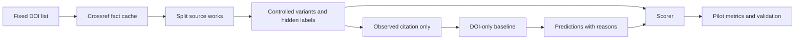

# Frozen protocol v1.0 — Prompt 07 — 2026-10-30

Frozen before acquiring the constructed dataset or measuring pilot performance. Machine settings: `configs/protocol.json`. Scope: Phase III baseline validation; the full comparison remains Phase IV.

## Input, output and controls
Input is a structured citation: DOI, title, surname list, publication year and venue. Output is pass, flag or abstain, with a reason. The scorer alone sees labels, source IDs and corruption categories. No reference parsing, language model, model training or citation-support checking is included.

B1 DOI-only: normalize DOI URL/prefix/case, query cached Crossref registration; registered DOI passes, 404 flags, missing DOI abstains. A flag means unresolved in Crossref, not proven nonexistent. Network failures abort rather than count as hallucinations.

B2 planned comparator: use exactly the same DOI lookup and compare title (SequenceMatcher >=0.90), normalized surname-set Jaccard (>=0.80), exact year and normalized venue. Missing DOI abstains. This is DOI-anchored metadata checking, NOT a Crossref title-search retrieval system. Both are original teaching implementations inspired by database verification; neither reproduces full RefChecker. B2 has unit checks only in Phase III, not a measured comparison.

## Dataset and partition
Use the 12 preregistered DOI records in the configuration, with deterministic shuffle seed 20261030. Reject incomplete or unavailable source records without silently substituting them. Assign four source works to development/pilot and eight to held-out test BEFORE constructing variants. Generate eight variants per source: clean, format-only, missing DOI, wrong year (+7), replaced author list, DOI of another real work, title of another real work (Frankenstein), and deliberately synthetic unmatched item. Donors are restricted to the same partition. Ground truth is a mutation ledger, not an independent expert audit.

The public registry lookup is allowed to access the real test works: this is retrieval infrastructure, not learned training leakage. Prohibit use of the source ID, category or labels by predictors, and prohibit pilot/test donor overlap. Do not tune thresholds on held-out outputs. No held-out predictions will be generated during Phase III.

Any-error positives: wrong_year, wrong_author, wrong_doi, frankenstein, synthetic_unmatched. Clean/format-only/missing-DOI are valid negatives. Identity-only positives: wrong_author, frankenstein, synthetic_unmatched; a wrong DOI is reported separately as an identifier error. This operational identity definition is a local convention, not asserted to exactly reproduce Russinovich et al. A fabricated title is a synthetic fixture; its worldwide nonexistence has not been proved.

## Measures and decision rules
Primary later comparison: macro recall across the five error categories under any-error labels; report precision, micro recall, F1, false-positive rate and coverage too. Higher precision/recall/F1/coverage is better; lower FPR is better. Recall denominator includes all positives, including abstentions. Precision is undefined if there are no flags. Report support counts and confusion counts rather than suppressing undefined metrics. Pilot output is descriptive validation, not a test of research hypotheses.

Prespecified practical improvement threshold for Phase IV: B2 macro recall at least 0.10 greater than B1, with no more than 0.05 absolute increase in FPR. Report differences even if this rule fails. Paired uncertainty should resample source groups, not independent mutated rows; the eight-source held-out set is too small for broad significance claims. Scale source count under an explicitly logged amendment before evaluating it if stronger inference is needed.

Deeper planned analysis: error-type breakdown and rescore under identity-only labels. Keep wrong-year metadata errors distinct from genuine preprint/published-version drift; no real version-drift claim is justified by adding seven years. Keep the five false-positive mechanisms in the original gap matrix as FUTURE work: this pilot does not model indexing lag, editors, extraction errors or same-title real works.

Resources: CPU, no paid APIs, no training; serial requests, 45-second timeout, four attempts, backoff for transient errors, cache facts only. Budget: fewer than 25 initial API calls plus retries; at most roughly 20 minutes with failures. No wall-time efficiency comparison on cached versus uncached runs. Expected outputs: environment JSON, source/label manifest, baseline prediction CSV, overall and per-category metrics JSON, pilot recall SVG, tests and validation report. No anticipated numeric results.

Pre-experiment checklist: fixed seed and source list; source-disjoint partitions; same lookup cache for comparators; primary metric/thresholds specified; no human sign-off invented; test evaluation deferred. Protocol changes must state date, reason, affected results and whether outputs had already been inspected. Keep old output or clearly rerun affected results.

Threats: convenience source sample, low source count, artificial corruption prevalence/severity, same-registry ground truth/lookup circularity, surname collisions, missing metadata, registry coverage, no multilingual coverage and no natural LLM errors. A zero pilot FPR does not establish production safety. Paper-level rates are not meaningful here because no natural reports were sampled.
